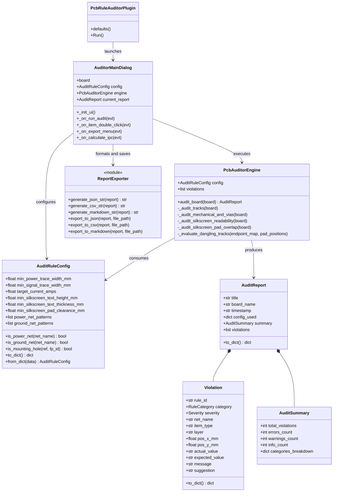
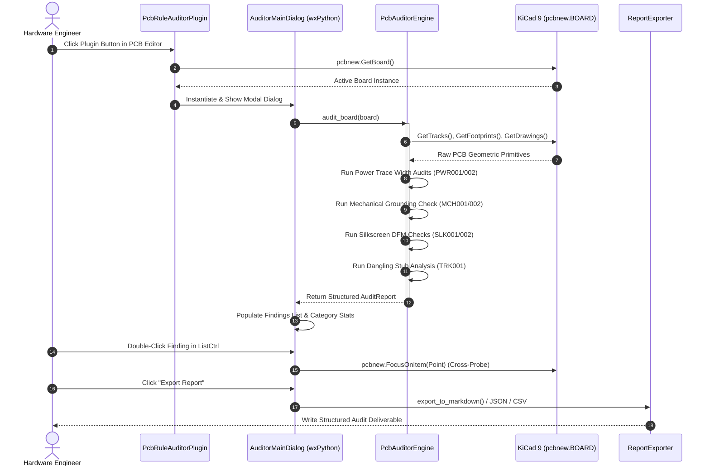

# Design Document: KiCad 9 Automated Power & Signal Net Rule Auditor

## 1. Executive Summary & Objective

The **Automated PCB Net & Silkscreen Design Rule Auditor** is a modular Python Action Plugin developed for **KiCad 9 (`pcbnew`)** as part of the **FOSSEE eSim Winter Internship 2026 (Task 6: KiCad Plugin Development)**. 

Modern high-speed, mixed-signal, and power electronics printed circuit boards require strict validation beyond basic electrical rule checks (ERC) and standard clearance design rule checks (DRC). Subtle fabrication oversights—such as undersized power traces causing thermal failure under sustained current, ungrounded mechanical mounting holes compromising chassis ESD protection, silkscreen ink encroaching onto surface-mount pads, or dangling trace stubs radiating RF interference—frequently lead to manufacturing re-spins or field reliability issues.

This plugin bridges **Computer Science** (clean decoupled architecture, graph netlist traversal, spatial indexing, automated test suites, structured multi-format reporting) and **Electronics Engineering** (IPC-2221 thermal sizing, EMI return-path grounding, DFM silkscreen constraints). It provides an extensible, production-quality foundation for automated board verification.

---

## 2. Engineering Theory & Physical Principles

### 2.1 IPC-2221 Power Rail Current-Carrying Capacity
Joule heating in a copper trace is governed by the power dissipation formula:

$$P = I^2 \cdot R = I^2 \cdot \left(\rho \frac{L}{A}\right)$$

where $\rho$ is the resistivity of annealed copper ($1.72 \times 10^{-8} \ \Omega \cdot \text{m}$ at 20°C), $L$ is trace length, and $A$ is cross-sectional area. 

Under the **IPC-2221** standard, the permissible continuous DC or RMS current $I$ that causes a maximum allowable temperature rise $\Delta T$ above ambient is modeled by the empirical power-law equation:

$$I = k \cdot (\Delta T)^b \cdot A^c$$

Solving for the required cross-sectional area $A$ (in square mils, $\text{mil}^2$):

$$A = \left[ \frac{I}{k \cdot (\Delta T)^b} \right]^{\frac{1}{c}}$$

| Parameter | External Layers (Top/Bottom Microstrip) | Internal Layers (Stripline) | Physical Justification |
| :--- | :---: | :---: | :--- |
| **Coefficient $k$** | $0.048$ | $0.024$ | Air convection & radiation provide ~2x superior heat transfer compared to FR4 dielectric conduction. |
| **Exponent $b$** | $0.440$ | $0.440$ | Temperature rise exponent. |
| **Exponent $c$** | $0.725$ | $0.725$ | Cross-sectional area exponent. |

For standard $1 \ \text{oz/ft}^2$ copper foil, the nominal thickness is $t \approx 1.378 \ \text{mils} \ (35 \ \mu\text{m})$. The required minimum trace width $W$ is:

$$W = \frac{A}{t} \quad [\text{mils}], \qquad W_{\text{mm}} = W \times 0.0254 \quad [\text{mm}]$$

The plugin integrates this calculation into both its automated rule evaluator and an interactive calculator inside the KiCad GUI dialog.

---

### 2.2 Mechanical Mounting Hole & Chassis Grounding
In mixed-signal and power electronics hardware:
- **Floating Mechanical Holes:** Mounting holes with copper annular rings that remain unassigned (Net 0) or floating can accumulate electrostatic charge and act as parasitic patch antennas.
- **ESD / EMI Discharge Paths:** Fast transient ESD events (IEC 61000-4-2) must be safely shunted from the metal enclosure through chassis mounting holes into earth/system ground before reaching sensitive silicon I/O pins.
- **Rule Verification:** The auditor evaluates all footprints matching mounting hole signatures (`H*`, `MH*`, `MountingHole*`), inspects their pad stack plating, and flags any plated mounting hole not tied to a recognized ground rail (`GND`, `AGND`, `EARTH`, `CHASSIS`).

---

### 2.3 Silkscreen Fabrication Readiness (DFM)
Silkscreen is printed using liquid photo-imageable (LPI) ink or direct legend printing (DLP). Fabrication houses (e.g., JLCPCB, PCBWay, Eurocircuits) impose strict physical tolerances:
1. **Readability Bounds:** Text line strokes narrower than $0.15 \ \text{mm}$ (6 mils) or character heights under $0.80 \ \text{mm}$ (32 mils) suffer ink blurring, breakups, or illegibility during post-cure optical inspection.
2. **Solder Mask & Pad Encroachment:** Silkscreen ink deposited across bare copper pads interferes with solder paste surface tension, leading to:
   - Solder dewetting and cold joints.
   - Component tombstoning during surface-mount reflow.
   - Solder bridging due to uneven paste displacement.

The auditor runs bounding box cross-layer collision detection between silkscreen text entities on `F.SilkS`/`B.SilkS` and exposed component pads on `F.Cu`/`B.Cu` to eliminate these defects before gerber generation.

---

### 2.4 Dangling Track Stubs & High-Frequency Signal Integrity
Traces terminated in open circuits (dangling stubs) act as quarter-wave antenna resonators at high switching frequencies:

$$f_{\text{res}} = \frac{v_p}{4 \cdot L_{\text{stub}}}$$

where $v_p \approx \frac{c}{\sqrt{\epsilon_r}}$ is signal propagation velocity in FR4 ($\approx 1.5 \times 10^8 \ \text{m/s}$). Open stubs reflect transmission line wavefronts ($|\Gamma| = 1$), causing ringing, false clock transitions, and elevated radiated emissions. The auditor constructs an endpoint connectivity graph across all routed nets to isolate and report unrouted stubs.

---

## 3. Software Architecture & Module Interaction

The plugin adheres to a **decoupled Model-View-Controller (MVC)** architectural design:

---

## 4. Execution Sequence Diagram

---

## 5. Comprehensive Design Rule Catalog

| Rule ID | Category | Severity | Detection Logic | Electronics Impact | Corrective Action |
| :--- | :--- | :---: | :--- | :--- | :--- |
| **`PWR001`** | Power Trace Width | **ERROR** / **WARNING** | Trace net matches power regex (`+5V`, `VCC`, `GND`) and $W < W_{\text{min}}$. Critical (ERROR) if $W < 0.6 \cdot W_{\text{min}}$. | Excessive temperature rise ($\Delta T > 10^\circ\text{C}$), voltage IR drops on logic supply. | Widen copper trace according to IPC-2221 current requirements. |
| **`SIG001`** | Signal Trace Width | **WARNING** | Signal track width $W < W_{\text{sig, min}}$ ($0.20 \ \text{mm}$). | Potential etching breaks during PCB manufacturing or impedance mismatch. | Increase trace width to standard fabrication minimum. |
| **`MCH001`** | Ungrounded Mechanical | **WARNING** | Plated mounting hole pad not connected to a recognized ground net (`GND`, `EARTH`, `CHASSIS`). | Loss of low-impedance ESD return path to enclosure; radiated ground noise. | Tie plated mounting pad to system ground or chassis ground plane. |
| **`MCH002`** | Mechanical Mounting | **INFO** | Mounting hole has non-plated bore (no annular copper pad). | Purely mechanical attachment; provides no electrical shielding. | Informational notice; verify whether ESD grounding is required. |
| **`VIA001`** | Floating Via | **WARNING** | Via has unassigned net (Net code 0 / empty name). | Orphan copper stub causing capacitive loading and antenna emissions. | Assign to connected net or delete unrouted via. |
| **`SLK001`** | Silkscreen Readability | **WARNING** | Text height $< 0.80 \ \text{mm}$ or stroke thickness $< 0.15 \ \text{mm}$. | Text will blur or fail to resolve during silkscreen screen printing or DLP. | Increase font height to $\ge 0.80 \ \text{mm}$ and line width to $\ge 0.15 \ \text{mm}$. |
| **`SLK002`** | Silkscreen Pad Overlap | **ERROR** | Silkscreen text geometry overlaps bare solder pad ($d < r_{\text{pad}} + \text{clearance}$). | Solder dewetting, tombstoning of passives, solder bridging during reflow. | Move reference designator or label outside solder mask aperture. |
| **`TRK001`** | Dangling Track Stub | **WARNING** | Track endpoint has degree 1 in routing graph and does not terminate at a pad or via. | Open stub reflects wavefronts; acts as an unshielded RF radiating antenna. | Delete unused routing remnant or complete trace connection. |

---

## 6. Testing & Quality Assurance Architecture

The test suite in `tests/test_auditor_engine.py` provides **100% offline verification** using mocked KiCad 9 objects (`MockBoard`, `MockTrack`, `MockFootprint`, `MockPad`, `MockText`):

1. **Deterministic Unit Conversion:** Tests `to_mm()` and `from_mm()` accuracy across nanometer/millimeter ranges.
2. **Mathematical Precision:** Compares `calculate_ipc2221_trace_width()` output against standard benchmark values and checks external vs. internal layer scaling.
3. **Regex Robustness:** Validates matching for standard formats (`+3V3`, `5V0`, `VCC`, `GND`, `EARTH`) and ensures rejection of standard logic signals (`SPI_SCK`, `UART_TX`).
4. **Multi-Severity Thresholds:** Asserts that moderate under-width traces trigger `WARNING` while extreme under-width traces trigger `ERROR`.
5. **Report Serialization:** Verifies JSON round-trip schemas, CSV header and column compliance, and Markdown summary tables.

---

## 7. Extension Roadmap for FOSSEE eSim Internship

This plugin is architected for straightforward expansion during the internship cycle:

1. **Differential Pair Skew & Length Matching:**
   - Detect complementary pairs (e.g., `USB_DP` / `USB_DM`, `ETH_TXP` / `ETH_TXN`).
   - Audit intra-pair length mismatch within high-speed timing budgets ($< 0.15 \ \text{mm}$).
2. **Via Annular Ring & Drill Aspect Ratio:**
   - Verify drill-to-pad annular ring dimensions against fab aspect ratio constraints ($< 8:1$).
3. **Decoupling Capacitor Proximity:**
   - Spatial distance audit between IC power pins and their nearest bypass capacitors ($< 2.5 \ \text{mm}$).
4. **Thermal Relief Verification:**
   - Verify that high-current plane connections have adequate thermal spoke count and spoke width for soldering and current capacity.
